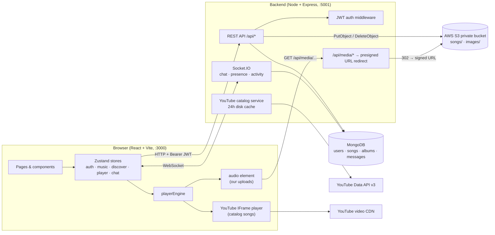
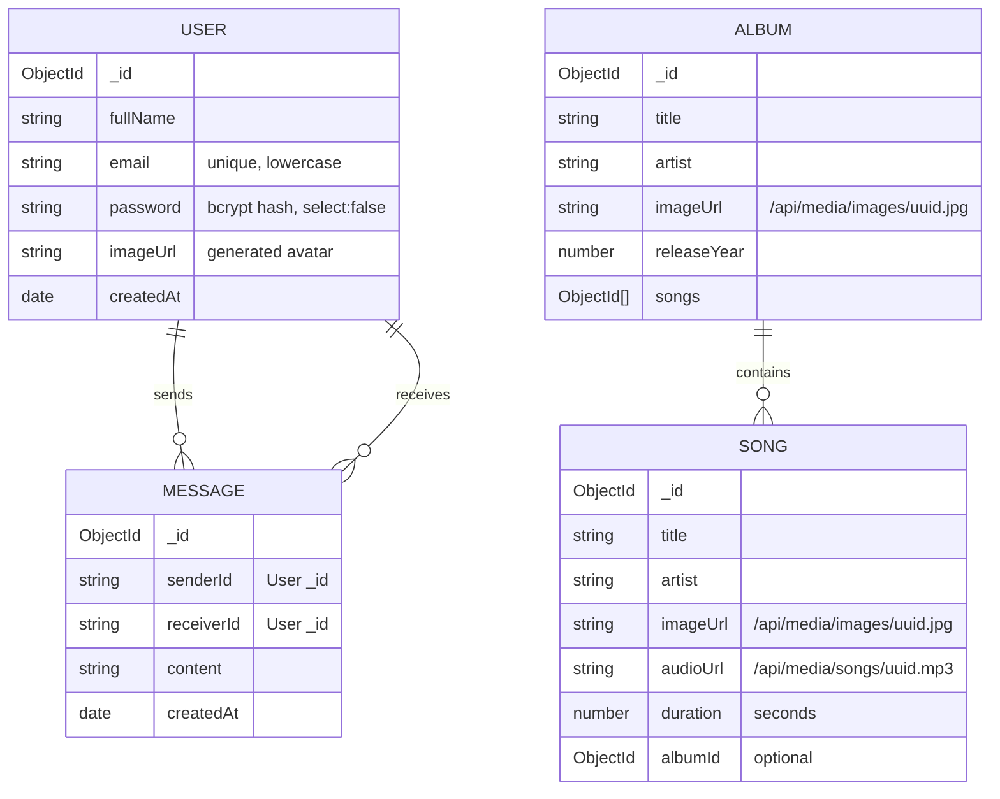
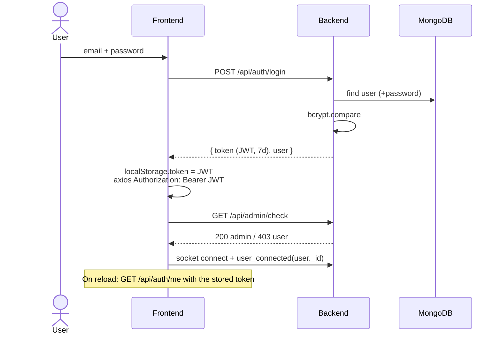
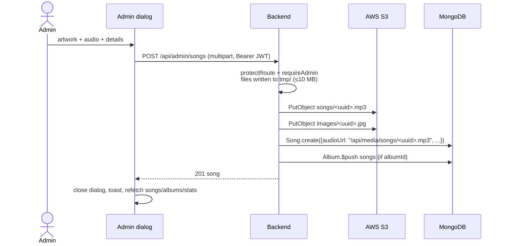
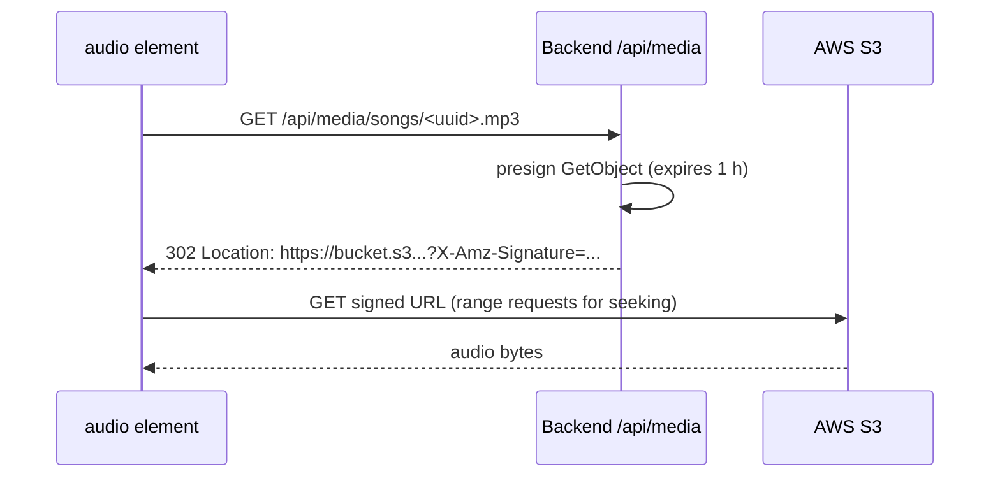
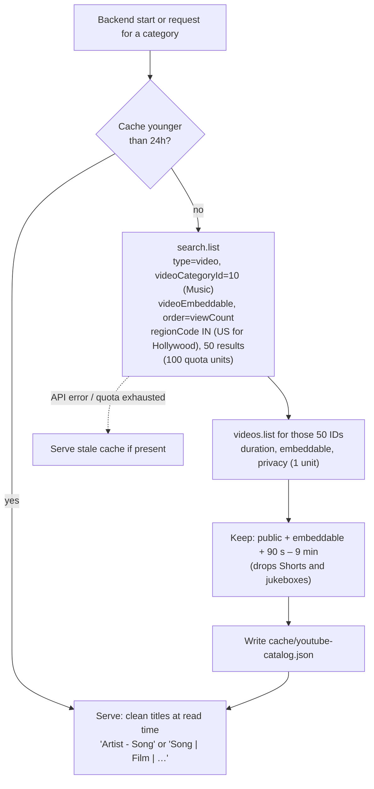

# System Design

A Spotify-style music app: users browse and play music, chat in real time and see what friends are listening to; an admin uploads songs and albums. Music comes from two sources — **our own uploads** (stored privately in AWS S3) and a **YouTube catalog** of Indian and international songs, both played full length.

For the step-by-step admin/user guide with screenshots see [system-flow.md](system-flow.md).

---

## 1. Architecture

### Tech stack

| Layer | Technology |
|---|---|
| Frontend | React 18, TypeScript, Vite, Tailwind CSS, shadcn/ui (Radix), Zustand, React Router, Axios, socket.io-client |
| Backend | Node.js, Express 4, Mongoose 8, Socket.IO 4, express-fileupload, node-cron |
| Auth | Email + password, `bcryptjs` hashing, `jsonwebtoken` (JWT, 7-day expiry) |
| Database | MongoDB (local via Homebrew, or MongoDB Atlas) |
| File storage | AWS S3 (private bucket) via `@aws-sdk/client-s3` + `@aws-sdk/s3-request-presigner` |
| Third-party music | YouTube Data API v3 (catalog) + YouTube IFrame Player API (playback) |

---

## 2. Components

### Frontend (`frontend/src`)

| Area | Files | Responsibility |
|---|---|---|
| Routing | `App.tsx` | `/`, `/login`, `/signup`, `/chat`, `/albums/:albumId`, `/admin` |
| Auth | `stores/useAuthStore.ts`, `providers/AuthProvider.tsx`, `pages/auth/AuthPage.tsx` | Login/signup, keeps JWT in `localStorage`, sets the `Authorization` header, checks admin status, starts the socket |
| Home & discovery | `pages/home/HomePage.tsx`, `stores/useDiscoverStore.ts`, `CategoryChips.tsx`, `SectionGrid.tsx` | Category chips (state in `?category=` URL param), "Uploaded by us" row, one row per YouTube category |
| Playback | `stores/usePlayerStore.ts`, `lib/playerEngine.ts`, `AudioPlayer.tsx`, `YouTubePlayer.tsx`, `PlaybackControls.tsx` | Queue, current song, play/pause/next/prev; `playerEngine` gives the bottom bar one API (time, duration, seek, volume) over both the `<audio>` element and the YouTube player |
| Chat & presence | `stores/useChatStore.ts`, `pages/chat/*`, `FriendsActivity.tsx` | Socket connection, online users, "now playing" activity, messages |
| Admin | `pages/admin/*`, `stores/useMusicStore.ts` | Stats, songs/albums tables, Add Song / Add Album dialogs (multipart upload), delete |

### Backend (`backend/src`)

| Module | Responsibility |
|---|---|
| `index.js` | Express app, CORS, JSON + multipart parsing (temp files in `tmp/`, 10 MB limit), routes, error handler, hourly `tmp/` cleanup cron, starts Socket.IO and warms the YouTube cache |
| `middleware/auth.middleware.js` | `protectRoute` verifies the JWT and loads `req.user`; `requireAdmin` compares `req.user.email` with `ADMIN_EMAIL` |
| `controller/auth.controller.js` | Signup (bcrypt hash, generated avatar), login, `me` |
| `controller/admin.controller.js` | Create/delete songs and albums; uploads to and deletes from S3 |
| `lib/s3.js` | `uploadToS3`, `deleteFromS3`, `getMediaUrl` (presigned GET, 1 h) |
| `routes/media.route.js` | `GET /api/media/*` → 302 redirect to a presigned S3 URL |
| `lib/youtube.js` | Builds the 14-category catalog from the YouTube Data API, filters, cleans titles, caches to `cache/youtube-catalog.json` |
| `lib/socket.js` | Presence (`user_connected`, `users_online`), activity (`update_activity`), chat (`send_message`) |

---

## 3. Data model

YouTube catalog songs are **not** stored in MongoDB. They live in the disk cache and are returned in the same shape as `Song`, plus `source: "youtube"`, `youtubeId`, `channel` and `externalUrl`. `_id` is `yt-<videoId>` so it never collides with Mongo IDs.

---

## 4. API

Base URL: `http://localhost:5001/api` (in production: same origin, `/api`).

| Method | Path | Auth | Description |
|---|---|---|---|
| POST | `/auth/signup` | — | `{fullName, email, password}` → `{token, user}` |
| POST | `/auth/login` | — | `{email, password}` → `{token, user}` |
| GET | `/auth/me` | User | Current user |
| GET | `/songs/library` | — | All uploaded songs, newest first |
| GET | `/songs/featured`, `/songs/made-for-you`, `/songs/trending` | — | Random samples of uploaded songs |
| GET | `/songs` | Admin | All uploaded songs (admin table) |
| GET | `/albums`, `/albums/:albumId` | — | Albums / one album with songs |
| GET | `/discover/categories` | — | `[{id, name, group}]` |
| GET | `/discover/home?limit=12` | — | Every category with its first N songs |
| GET | `/discover/:categoryId` | — | One category (~50 songs) |
| GET | `/media/*` | — | 302 redirect to a presigned S3 URL (1 h) |
| GET | `/users` | User | All other users (chat list) |
| GET | `/users/messages/:userId` | User | Conversation with a user |
| GET | `/stats` | Admin | Totals: songs, albums, users, artists |
| GET | `/admin/check` | Admin | `{admin: true}` (403 otherwise) |
| POST | `/admin/songs` | Admin | multipart: `audioFile`, `imageFile`, `title`, `artist`, `duration`, `albumId?` |
| DELETE | `/admin/songs/:id` | Admin | Deletes song + its S3 files |
| POST | `/admin/albums` | Admin | multipart: `imageFile`, `title`, `artist`, `releaseYear` |
| DELETE | `/admin/albums/:id` | Admin | Deletes album, its songs and all their S3 files |

### Socket.IO events

| Direction | Event | Payload |
|---|---|---|
| client → server | `user_connected` | `userId` |
| server → all | `user_connected` / `user_disconnected` | `userId` |
| server → client | `users_online` | `userId[]` |
| client → server | `update_activity` | `{userId, activity}` e.g. `"Playing Song by Artist"` / `"Idle"` |
| server → all | `activities` / `activity_updated` | all activities / one update |
| client → server | `send_message` | `{senderId, receiverId, content}` |
| server → client | `receive_message` (receiver), `message_sent` (sender) | saved `Message` |

---

## 5. Key flows

### 5.1 Sign up / log in

### 5.2 Admin uploads a song

### 5.3 Playing an uploaded song (private S3)

The bucket stays fully private (Block Public Access on). The database stores stable `/api/media/...` paths, not expiring URLs; a fresh signed URL is minted on every request. In development Vite proxies `/api` to the backend so relative media URLs work on `:3000`.

### 5.4 YouTube catalog

- 14 categories × ~101 units ≈ **1,400 units per refresh**; free quota is **10,000/day**, and the cache keeps it to about one refresh per day.
- The cache stores the raw YouTube title, so title-parsing rules can change without refetching.
- Adding a language means adding one line to `CATEGORIES` in `backend/src/lib/youtube.js`.

### 5.5 Unified playback

`usePlayerStore` holds the queue and current song for both sources. Two players react to it:

| Current song | `AudioPlayer` | `YouTubePlayer` |
|---|---|---|
| Upload (`source` undefined) | sets `src`, plays/pauses | pauses, mini player hidden |
| YouTube (`source: "youtube"`) | pauses | `loadVideoById` / play / pause, mini player visible |

`PlaybackControls` polls `playerEngine` every 500 ms for time and duration and routes seek and volume to whichever player is active. When a song ends, either player calls `playNext()`. If a YouTube video errors (removed or region-blocked), it is skipped.

YouTube's terms require a visible player of at least 200×200 px and no audio-only extraction, so YouTube songs play in a small, visible, shrinkable mini player at the bottom left.

### 5.6 Real-time chat and activity

The server keeps `userId → socketId` and `userId → activity` maps in memory. The player emits `update_activity` on play, pause and song change, which drives the "What they're listening to" sidebar. Messages are saved to MongoDB and pushed to the receiver's socket if they are online.

---

## 6. Security

| Concern | Current design |
|---|---|
| Passwords | bcrypt (10 rounds); `password` field excluded from queries by default |
| Sessions | Stateless JWT (HS256, `JWT_SECRET`, 7 days) sent as `Authorization: Bearer`; stored in `localStorage` |
| Authorization | `protectRoute` on user routes; `requireAdmin` (email == `ADMIN_EMAIL`) on admin routes and stats |
| File storage | Private S3 bucket; access only through short-lived presigned URLs; random UUID object keys; S3 objects deleted with their song/album |
| AWS credentials | Never in code: the SDK default chain (`AWS_PROFILE` locally, IAM role in production) |
| Secrets | `backend/.env` is git-ignored; `.env.sample` has empty values only |
| Upload limits | 10 MB per file (express-fileupload); temp files purged hourly |

### Known gaps (recommended next steps)

1. **Socket events are not authenticated.** `send_message` trusts `senderId` from the client. Verify the JWT in the Socket.IO handshake and use the server-side user ID.
2. **`/api/media/*` is public.** Anyone with a media URL can play it. Fine for a public catalog; add `protectRoute` if uploads should be members-only.
3. **No rate limiting on `/auth/login`.** Add `express-rate-limit` before going public.
4. **JWT in `localStorage`.** Readable by XSS. An `httpOnly` cookie is safer.
5. **CORS origin is hard-coded** to `http://localhost:3000` (in `index.js` and `socket.js`). Move it to an env var for production.
6. **No confirmation before delete** in the admin tables.

---

## 7. Configuration

`backend/.env` (see `backend/.env.sample`):

| Variable | Example | Purpose |
|---|---|---|
| `PORT` | `5001` | API port (5000 is taken by macOS AirPlay) |
| `MONGODB_URI` | `mongodb://127.0.0.1:27017/spotify-clone` | Database |
| `ADMIN_EMAIL` | `you@example.com` | The account with admin rights |
| `NODE_ENV` | `development` / `production` | In production Express also serves `frontend/dist` |
| `JWT_SECRET` | 64 random hex chars | JWT signing key |
| `AWS_PROFILE` | `onekampus` | Local AWS credentials profile (omit when using an IAM role) |
| `AWS_REGION` | `ap-south-1` | S3 region |
| `AWS_S3_BUCKET` | `spotify-clone-media-<account-id>` | Private media bucket |
| `YOUTUBE_API_KEY` | `AIza…` | YouTube Data API v3 key (restrict it to that API) |

The frontend needs no env vars: in development it calls `http://localhost:5001`, in production the same origin.

Minimum IAM permissions for the backend: `s3:PutObject`, `s3:GetObject`, `s3:DeleteObject` on `arn:aws:s3:::<bucket>/*`.

---

## 8. Limits and scaling

| Item | Limit / behaviour |
|---|---|
| YouTube Data API | 10,000 units/day free; ~1,400 per catalog refresh; 24 h disk cache, stale data served on errors |
| Catalog size | ~48 songs × 14 categories ≈ 670 songs (raise `maxResults` / add queries for more) |
| Upload size | 10 MB per file |
| Presigned URL | 1 hour (re-issued on every `/api/media` request) |
| Socket.IO state | In-memory, so one backend instance only. To run several instances, add the Socket.IO Redis adapter and move presence/activity into Redis. |
| Catalog cache | Per instance on local disk; for several instances use Redis or S3 for the cache file |

### Production deployment outline

1. `npm run build --prefix frontend`. Then `NODE_ENV=production npm start --prefix backend` serves the API, Socket.IO and the built frontend from one origin.
2. Run on EC2, Lightsail, ECS or Elastic Beanstalk with an **IAM role** for S3 instead of a profile.
3. Use **MongoDB Atlas** (or DocumentDB) instead of local MongoDB.
4. Put it behind HTTPS (ALB or Nginx), set the CORS origin through an env var, and set strong `JWT_SECRET` and `ADMIN_EMAIL` values.
