# System Flow — Admin & User Guide

Step-by-step guide to using the music app, with screenshots. There are two roles:

| Role | Who | What they can do |
|---|---|---|
| **User** | Anyone who signs up | Browse and play music, filter by category, chat with other users, see what friends are listening to |
| **Admin** | The account whose email equals `ADMIN_EMAIL` in `backend/.env` | Everything a user can do **plus** upload / delete songs and albums from the Admin Dashboard |

Songs come from two sources:

| Source | Shown as | Plays | Managed by |
|---|---|---|---|
| **Our uploads** | "Uploaded by us" row / chip | Full length from our private **AWS S3** bucket | Admin (this guide, Part 2) |
| **YouTube catalog** | 14 category rows (Bollywood, Hollywood, Punjabi, Bhojpuri, Telugu, …) | Full length through YouTube's official embedded player | Automatic — refreshed every 24h from the YouTube Data API |

For architecture details see [system-design.md](system-design.md).

---

## Part 0 — Run the app locally

1. Start MongoDB (installed with Homebrew):
   ```bash
   brew services start mongodb-community
   ```
2. Create `backend/.env` from `backend/.env.sample` and fill in:
   - `ADMIN_EMAIL` — the email you will sign up with as admin
   - `JWT_SECRET` — any long random string (`openssl rand -hex 32`)
   - `AWS_PROFILE`, `AWS_REGION`, `AWS_S3_BUCKET` — the S3 bucket for uploads
   - `YOUTUBE_API_KEY` — a Google Cloud API key with **YouTube Data API v3** enabled
3. Install and start both apps:
   ```bash
   npm install --prefix backend && npm run dev --prefix backend
   ```
   ```bash
   npm install --prefix frontend && npm run dev --prefix frontend
   ```
4. Open **http://localhost:3000**. The backend runs on **http://localhost:5001** (port 5000 is used by macOS AirPlay).

> First start: the backend fetches the YouTube catalog in the background (~10 s). It is then cached in `backend/cache/` for 24 hours.

---

## Part 1 — User flow

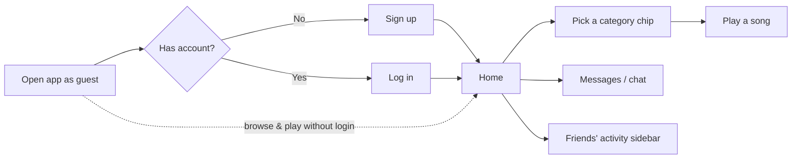

### Step 1 — Open the app (guest)

Anyone can browse and play music without an account. The home page shows:
- **Category chips** at the top: *All*, *Uploaded by us*, *Bollywood Hits*, *Hollywood / English*, *Punjabi*, *Bhojpuri*, … *Odia*
- **Featured** songs and the **Uploaded by us** row (our own full-length songs)
- One row per YouTube category, grouped by region (Bollywood & Hollywood → North Indian → South Indian → West & East Indian)

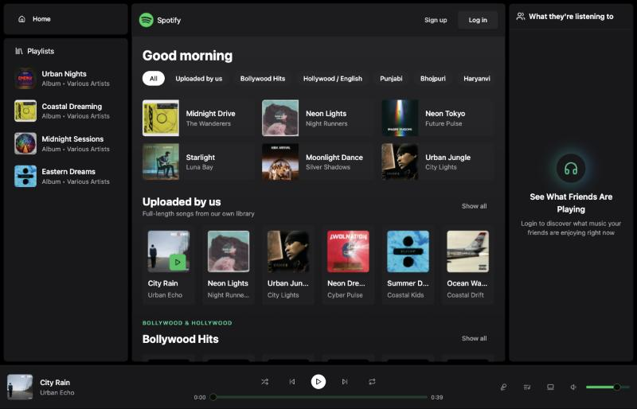

### Step 2 — Sign up

Click **Sign up** (top right). Enter full name, email and a password (min. 6 characters) → **Sign up**. You are logged in immediately and an avatar is generated from your initials.

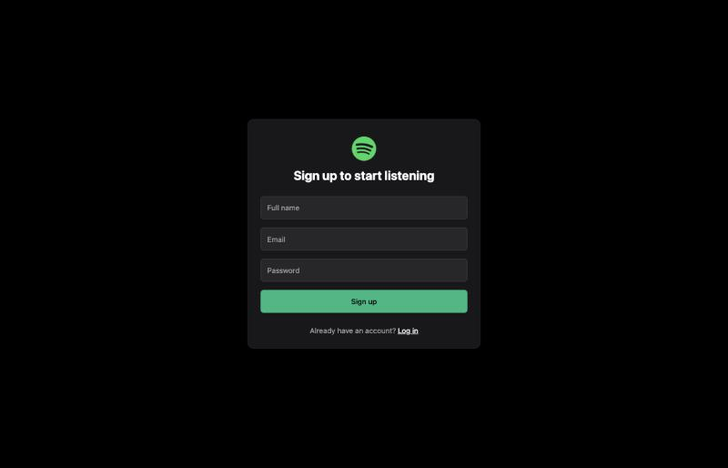

### Step 3 — Log in

Returning users click **Log in**, enter email + password → **Log in**. The session lasts 7 days.

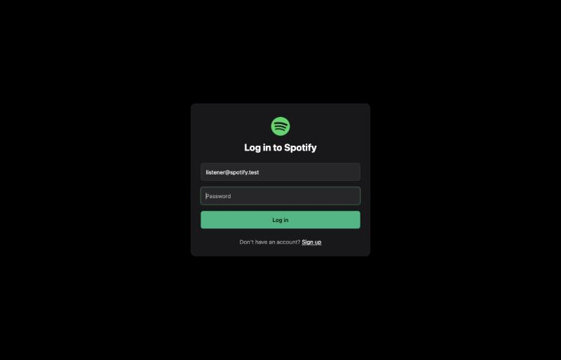

### Step 4 — Home (logged in)

After login you get:
- **Messages** in the left menu
- **Your avatar** and a **log out** button (top right)
- **"What they're listening to"** in the right sidebar — other users, online status and the song they are playing right now

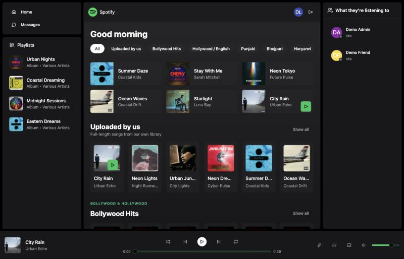

### Step 5 — Filter by category

Click any chip (e.g. **Bhojpuri**) or **Show all** on a row to see the full category (~50 songs). The URL changes to `/?category=bhojpuri`, so it can be bookmarked or shared.

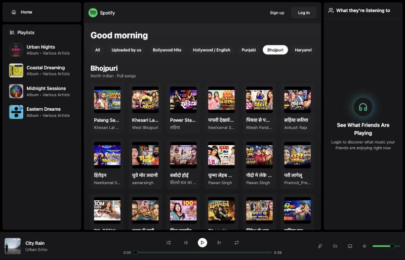

### Step 6 — Play a song

Hover a card and click the green **▶** button.
- **YouTube songs** play full length in the small video **mini player** at the bottom left. YouTube requires this player to stay visible; use the ⤡ icon in its corner to shrink it.
- **Our uploads** play directly in the bottom bar (no video).
- The bottom bar works for both: play / pause, previous / next (moves through the row you played from), seek and volume. When a song ends the next one starts automatically.

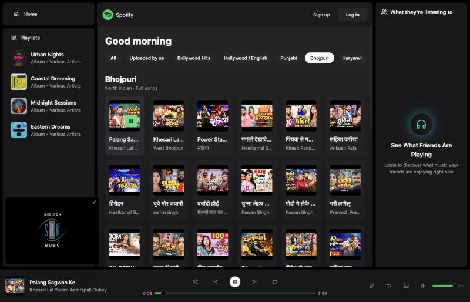

### Step 7 — Chat with other users

Click **Messages** → pick a user on the left → type and press **Enter**. Messages are delivered in real time (Socket.IO) and saved in MongoDB. The dot on each avatar shows online (green) / offline (grey).

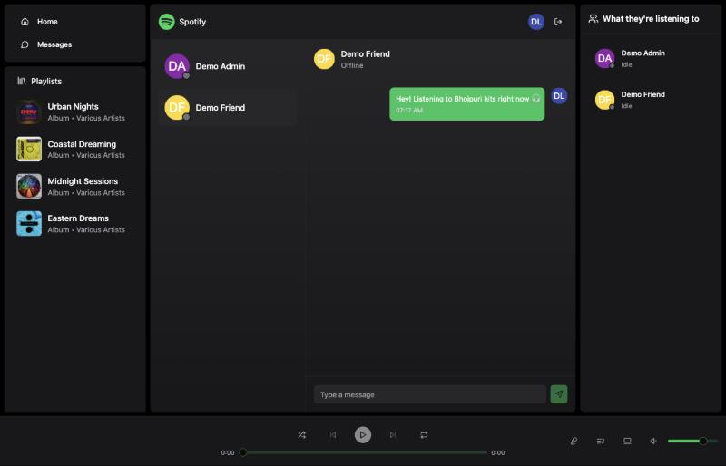

---

## Part 2 — Admin flow (uploading songs)

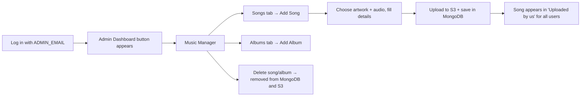

### Step 1 — Become admin and log in

1. Put your email in `backend/.env` → `ADMIN_EMAIL=you@example.com` and restart the backend.
2. **Sign up** (first time) or **Log in** with exactly that email.
3. An **Admin Dashboard** button appears in the top bar (only for the admin).

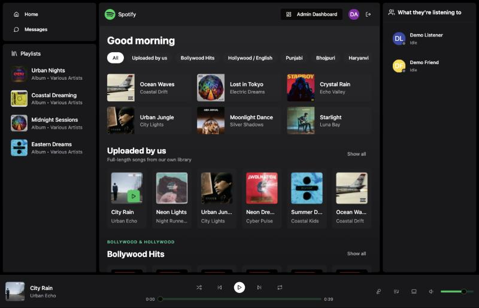

### Step 2 — Open the Music Manager

Click **Admin Dashboard**. You see totals (songs, albums, artists, users) and two tabs: **Songs** and **Albums**.

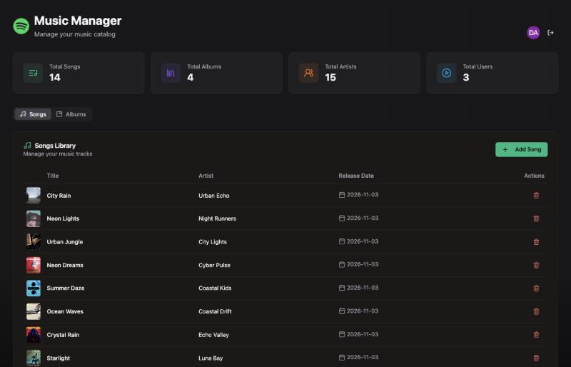

### Step 3 — Click "Add Song"

On the **Songs** tab click the green **+ Add Song** button.

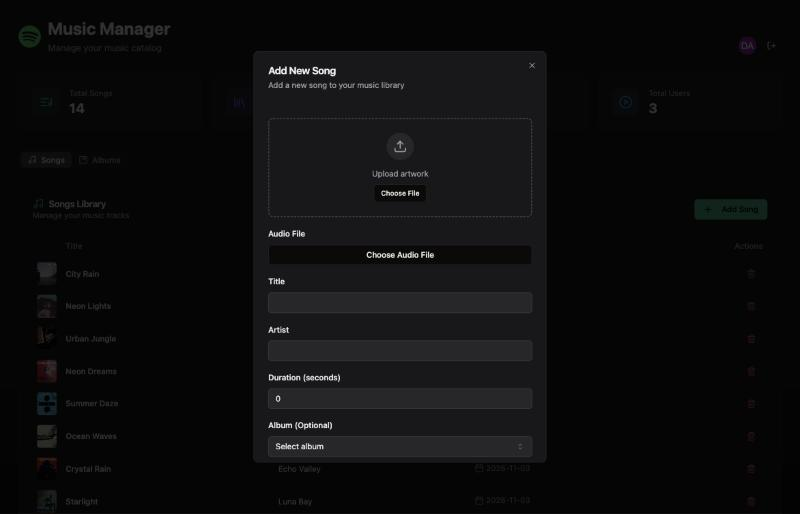

### Step 4 — Fill in the song details

| Field | What to enter |
|---|---|
| **Upload artwork** | Cover image (JPG / PNG). Square images look best. |
| **Audio File** | The song file (MP3 / M4A / WAV …). **Max 10 MB** per file. |
| **Title** | Song name |
| **Artist** | Artist / band name |
| **Duration (seconds)** | Length in seconds, e.g. `225` for 3:45 (shown in album track lists) |
| **Album (Optional)** | Pick an album, or *No Album (Single)* |

Then click **Add Song**. The button shows *Uploading…* while both files are sent to S3 (a few seconds depending on file size and connection).

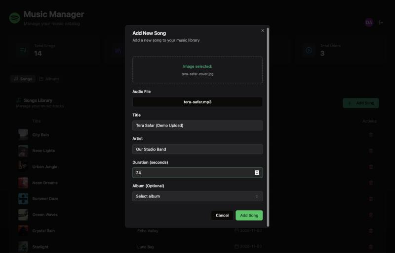

### Step 5 — Song is added

The dialog closes, a *Song added successfully* toast appears, and the new song is at the top of the **Songs Library** table. Totals update.

Behind the scenes the files are stored in S3 as `songs/<uuid>.mp3` and `images/<uuid>.jpg`, and the song is saved in MongoDB with URLs like `/api/media/songs/<uuid>.mp3`.

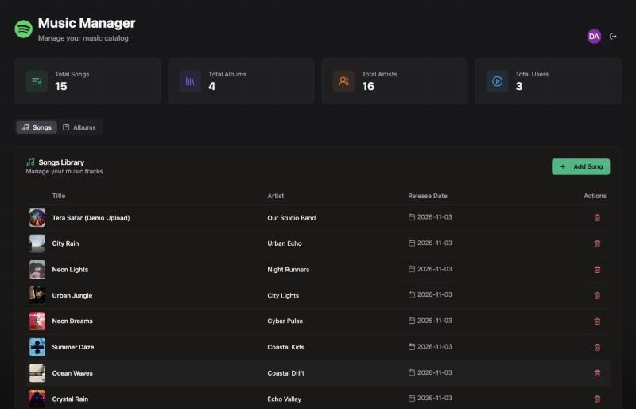

### Step 6 — (Optional) Create an album

On the **Albums** tab click **+ Add Album** → choose cover image, enter title, artist and release year → **Add Album**. New songs can then be assigned to it in Step 4, and the album appears in the left **Playlists** sidebar.

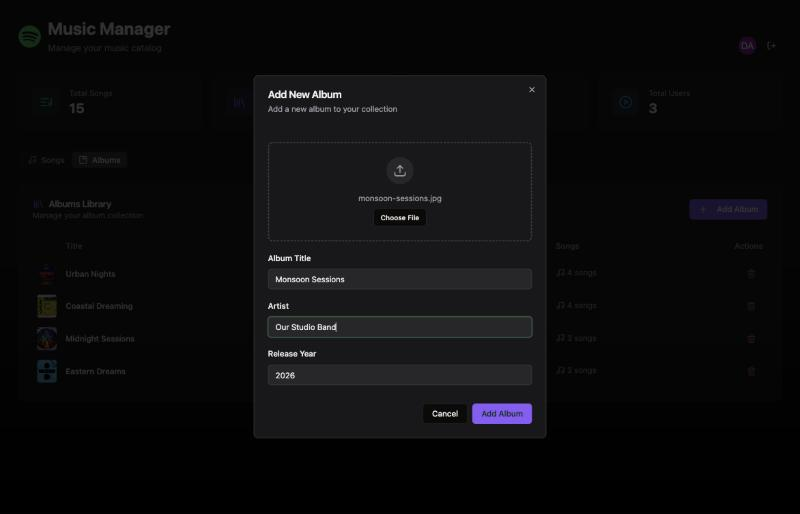

### Step 7 — The song is live for every user

Open the home page → **Uploaded by us**. Your song is there for all users and plays full length from S3.

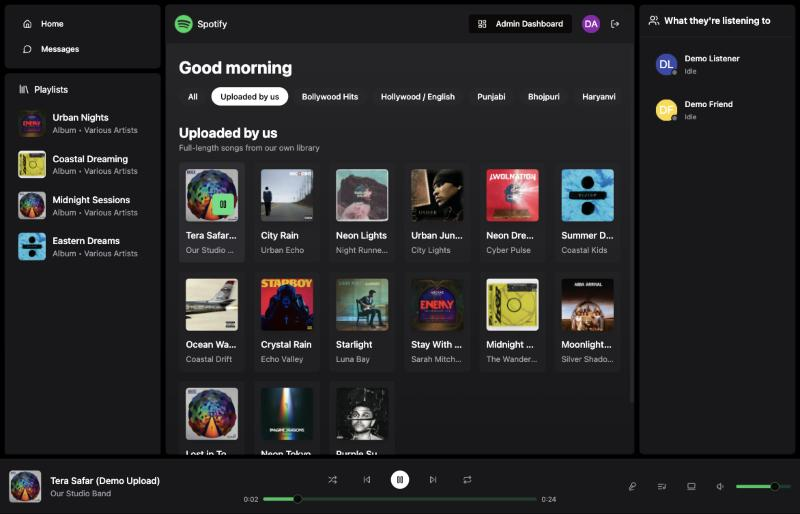

### Step 8 — Delete a song or album

Click the red 🗑 icon on a row. The song is removed from MongoDB **and** its audio and artwork are deleted from S3. Deleting an album also deletes all its songs and their files.

> ⚠️ There is no confirmation prompt — the delete happens immediately.

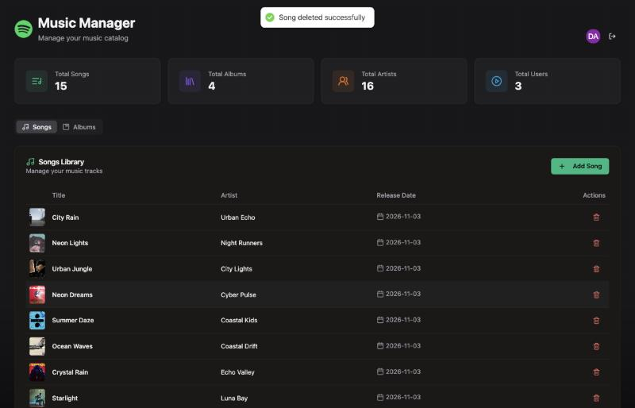

---

## Troubleshooting

| Problem | Fix |
|---|---|
| No **Admin Dashboard** button | Your login email must exactly match `ADMIN_EMAIL` in `backend/.env`; restart the backend after changing it and log in again. |
| *Failed to add song* | File larger than 10 MB, or AWS credentials / bucket in `backend/.env` are wrong. Check the backend terminal. |
| Category rows are empty | `YOUTUBE_API_KEY` missing or the daily YouTube quota (10,000 units) is used up. Cached data is served if available; it refills next day. |
| A YouTube song is skipped | The video was removed or can't be embedded in your region; the player moves to the next song automatically. |
| Backend won't start on 5000 | macOS AirPlay uses port 5000 — the app uses **5001**. |
